<p align="center">
  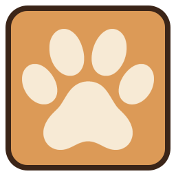
</p>

# Virtual Pet

A little pixel-art pet that lives on your desktop. It moves around on its own, sits when
you click it and goes wherever you drag it, but never off the screen.

## Premises and explanatory note

This program was conceived as a demonstration project, although a very simple one, of the
capabilities of AI models in developing and writing code. All of its content, from the folder
structure to the pets' art, was made, "thought through" and reviewed exclusively by artificial
intelligence models. The only exceptions are, explicitly, the following:

- the project's name and its general behavior;
- the types of pet and the settings;
- the text of this short explanatory note.

They make up the unique and truly creative character of this whole system, which therefore
carries in itself, despite my technical inabilities, the originality proper to the human mind.

If you wish to join in the game and fork the code, suggest a new pet or other improvements,
please don't betray the spirit in which the project was born. I ask that you do what, in
principle, seems absurd: do not change anything by yourself. Let the machines work.

## The pets

| | Pet | Gets around | Told to sit |
| :---: | --- | --- | --- |
| 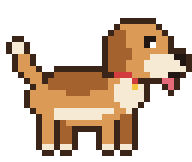 | Dog | Walks | Sits |
| 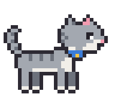 | Cat | Walks | Sits with its tail around its paws |
| 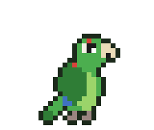 | Maritaca (a green Brazilian parakeet) | Flies | Fluffs up on the ground |
| 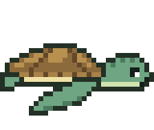 | Sea Turtle | Swims, and floats while it rests | Rests on the bottom |
| 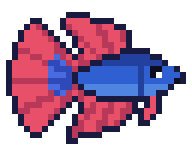 | Fish (a betta) | Swims, and floats while it rests | Rests on the bottom |
| 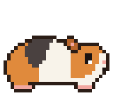 | Guinea Pig | Walks | Lies down like a loaf |
| 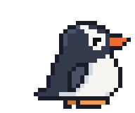 | Penguin (a gentoo) | Walks | Sits back on its tail |
| 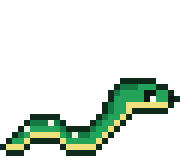 | Snake (in an emerald tree boa's colors) | Slithers | Coils up |
| 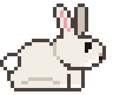 | Rabbit | Hops | Sits up on its haunches, sniffing |
| 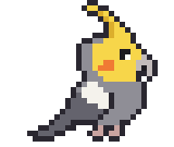 | Cockatiel | Flies | Fluffs up on the ground, crest down |
| 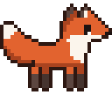 | Fox | Walks | Sits with its tail around its paws |
| 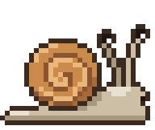 | Snail (a garden snail) | Crawls | Retreats into its shell |
| 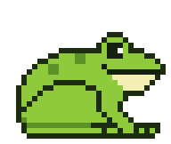 | Frog | Hops | Sits, and croaks now and then |
| 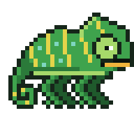 | Chameleon (a veiled chameleon) | Walks slowly | Lies down. Whenever it keeps still, a new color runs over it from head to tail |
| 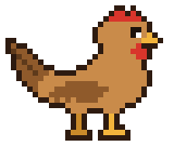 | Chicken (a brown hen) | Walks, and scratches and pecks whenever it stops | Settles on the ground like a hen on her nest |
| 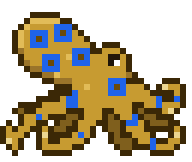 | Octopus (a blue-ringed octopus) | Crawls on its arms, its blue rings fading away | Rests low on the ground, its arms curled around it, its blue rings back |
| 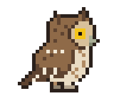 | Owl (a tropical screech owl) | Flies, and turns its head to look at you whenever it stops | Rests upright as owls roost, eyes half closed |
| 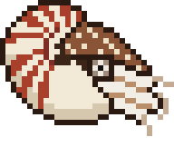 | Nautilus (a chambered nautilus) | Swims in jets, mostly shell first, and hovers between swims | Rests on the bottom with its hood let down |
| 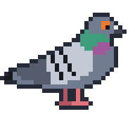 | Pigeon (a rock pigeon) | Walks bobbing its head, and pecks at the ground whenever it stops | Settles down on its belly |

## How to play

| Action | What happens |
| --- | --- |
| Leave it alone | It moves around the screen, resting now and then, in its own way (see [The pets](#the-pets)). |
| Left click | It sits and stays put. Click again and it goes back to roaming. |
| Drag | You carry it anywhere on the screen (including another monitor). Let go while moving the mouse fast and it flies off. |
| Right click | Menu: its name, Sit (or Rest, Coil up…) and the way it roams (Walk, Fly, Swim…), Pet, Turn around, Hide, Settings… and Quit. |
| Pet (in the menu) | A roaming pet stops for a moment and one or two pixel-art hearts float above it. |
| Turn around (in the menu) | It faces the other way. If it was on the move, it goes the other way instead. |
| Hide (in the menu) | It leaves the screen and waits in the system tray: click the paw print there to bring it back, where you left it. On desktops without a tray, open the app again instead. |
| Hover | Shows its name. |

On the first run you choose your pet and give it a name. Settings let you rename it, swap
it for another kind of pet, pick the language and set how hard it is thrown. There is only
ever one pet on the screen, and opening the app while it runs starts no second one: the
running one shows itself instead. The pet remembers which animal it is, its name, where you
left it, whether it was sitting and which way it was facing.

Both the first run and Settings offer to start the pet with the system (off unless you tick
it). On Linux that is an entry in `~/.config/autostart`, on Windows a value in your user's
Run key, so the desktop's own list of startup apps shows it and can turn it off too. If you
move the AppImage or the unzipped folder, open it once from its new place.

The pet goes online in two cases only: once a day it asks GitHub whether there is a newer
version (it only speaks if there is), and Ctrl+click on a pet in the adoption and settings
dialogs pops up its Wikipedia article. Set `VIRTUAL_PET_NO_UPDATE_CHECK` to turn the daily
check off.

## Requirements

- Linux with an X11 or Wayland desktop (tested on KDE Plasma 6, Wayland). On Wayland,
  XWayland must be available (it is by default on KDE Plasma and GNOME).
- From source only: Python 3.12+ and [uv](https://docs.astral.sh/uv/). Debian/Ubuntu
  also need `libxcb-cursor0` for Qt's X11 backend.
- Windows: 64-bit Windows 11, where the Windows build was tried on several PCs. Windows 10
  version 1903 or newer should work too, but hasn't been tried.

## Running

The AppImage is a single file with the pet, Python and Qt inside, so there is nothing else
to install. Make it executable (downloads lose that bit) and run it, or double-click it in
the file manager:

```bash
chmod +x VirtualPet-<version>-x86_64.AppImage
./VirtualPet-<version>-x86_64.AppImage
```

It runs on x86-64 Linux distributions whose glibc is at least as new as the build
machine's. Like every AppImage it mounts itself with FUSE; where that is missing,
`--appimage-extract-and-run` works too, but then Ctrl+C or logging out stops the pet
without saving where it was.

From source:

```bash
uv run virtual-pet       # or, to install it as a command for your user: uv tool install .
```

Only one copy of the app runs at a time. Quit it from the pet's right-click menu (or with
Ctrl+C when started from a terminal).

**On Windows**, the build is a zip with a `VirtualPet` folder: unzip it anywhere and run
`VirtualPet.exe`. The program isn't signed, so Windows SmartScreen warns about it the first
time ("More info", then "Run anyway"). With display scaling that isn't a whole number (125%
or 150%), the pet's pixels come out slightly uneven.

**Why XWayland on Wayland?** Wayland doesn't let applications place their own windows or
keep them above others, and a desktop pet needs both. So on Wayland sessions the pet runs
through XWayland automatically, as an unmanaged X11 window that stays on top and never takes
the keyboard focus from the application you are using.

## Settings file

Everything is stored in `~/.config/virtual-pet/config.json` (`$XDG_CONFIG_HOME` is
respected), or on Windows in `%LOCALAPPDATA%\virtual-pet\config.json`. Delete that file to
start over; the next run asks you to adopt a pet again. Starting with the system isn't in
that file: it stays as it was until you change it in Settings.

## Development

```bash
uv sync                    # create .venv with runtime and dev dependencies
uv run pytest              # tests (offscreen, no windows pop up) + coverage report
uv run ruff check .        # lint
uv run ruff format .       # format
uv run ty check src/       # type check
```

The code is in `src/virtual_pet/`, and [CLAUDE.md](CLAUDE.md) describes how it fits
together. Each pet is drawn as text grids, one character per pixel, in its own module in
`src/virtual_pet/pets/`, whose docstring describes the animal and the design choices.

### Translations

The texts in the code are English. Each other language has a Qt Linguist file,
`src/virtual_pet/translations/virtual_pet_<language>.ts`, and the `.qm` compiled from it,
which is what the app loads. After adding or changing texts in the code:

```bash
uv run pyside6-lupdate src/virtual_pet/*.py src/virtual_pet/pets/*.py -locations none \
    -no-obsolete -ts src/virtual_pet/translations/virtual_pet_pt_BR.ts
uv run pyside6-linguist src/virtual_pet/translations/virtual_pet_pt_BR.ts  # translate them
uv run pyside6-lrelease src/virtual_pet/translations/virtual_pet_pt_BR.ts  # the .qm
```

The tests fail while a text is untranslated, or a `.qm` is older than its `.ts`. A new
language needs its code and name in `LANGUAGES` (`i18n.py`) and a `.ts` file, made by the
first command with `-target-language <code>` and the file named after that code.

### Building

```bash
uv run appimage/build.py   # dist/VirtualPet-<version>-x86_64.AppImage
uv run windows/build.py    # dist/VirtualPet-<version>-windows-x64.zip
```

Both run their own process tests on the result (`--skip-tests` skips them), and bundle
every dependency with its license text and a `THIRD-PARTY-NOTICES.txt`; the build stops if
it can't find the license of a bundled file.

- **AppImage.** It builds in its own environment (`build/appimage/venv`) with uv's own
  Python, whatever Python the project's `.venv` uses. The AppImage needs glibc at least as
  new as the build machine's (the build prints the version), so build on the oldest
  distribution it should run on, for example in a [distrobox](https://distrobox.it/)
  container. The build machine also needs the libraries that go into the bundle
  (`libxcb-cursor0` and GTK 3 on Debian/Ubuntu); the build names any that are missing. The
  first build downloads uv's Python, appimagetool and the AppImage runtime, and the license
  texts of that Python's full build (about 130 MB), into `build/appimage/tools/`.
- **Windows.** PyInstaller can't build for another system, so the Windows zip is built on
  Linux with Wine (tested with Wine 11), running Windows' Python in a prefix of the build's
  own (`build/windows/wine`; `~/.wine` is never touched). Qt asks Windows for its ICU
  library, which Wine lacks, so the prefix gets a stub of it that never goes into the
  bundle. Wine isn't Windows, though: the test shows that the bundle is complete, not how
  the pet behaves on a Windows desktop, which only trying it on Windows tells.

### Releasing

The version is in `pyproject.toml`, and a release is the commit that sets it, tagged
`v<version>`:

```bash
uv version --bump minor        # or patch, or major: changes pyproject.toml and uv.lock
git commit --message "chore(release): 0.5.0" pyproject.toml uv.lock
git tag --annotate v0.5.0 --message "Virtual Pet 0.5.0"
git push --follow-tags
```

The pushed tag starts the Release workflow (`.github/workflows/release.yml`): it runs the
checks and the tests, builds the AppImage (on Ubuntu 22.04, so it needs glibc 2.35) and the
Windows zip (under Wine), and attaches both to a draft release on GitHub, which is then
reviewed and published by hand.

The build asks git which commit it is building, so it runs in a clone of the repository.
Only a clean checkout of the release's tag makes `VirtualPet-<version>-x86_64.AppImage`;
any other commit adds itself to the name (`VirtualPet-0.5.0+g1a2b3c4-x86_64.AppImage`),
followed by `.dirty` when files git tracks have uncommitted changes, and a release tag that
isn't the version in `pyproject.toml` stops the build.

### Agent skills

`.claude/skills/` holds the project-scoped agent skills. `draw-pet` is the project's own.
The others are unmodified third-party copies pinned in `skills-lock.json`, each with its
license in its folder:

- `modern-python` ([Trail of Bits](https://github.com/trailofbits/skills), CC BY-SA 4.0)
- `qt-ui-design` ([The Qt Company](https://github.com/TheQtCompanyRnD/agent-skills), BSD-3-Clause)
- `tdd` ([Matt Pocock](https://github.com/mattpocock/skills), MIT)

## License

Copyright (C) 2026 Gabriel Quilice

Virtual Pet is free software: you can redistribute it and/or modify it under the terms
of the GNU General Public License, version 3, as published by the Free Software
Foundation. It is distributed in the hope that it will be useful, but WITHOUT ANY
WARRANTY; without even the implied warranty of MERCHANTABILITY or FITNESS FOR A
PARTICULAR PURPOSE. See [LICENSE](LICENSE) for the full text.

The agent skills in `.claude/skills/` keep their own licenses (see
[Agent skills](#agent-skills)). The AppImage also contains third-party software (Python,
Qt for Python, ICU, PyInstaller's bootloader and libraries of the build machine's
distribution), each under its own license, listed in its `THIRD-PARTY-NOTICES.txt`. So
does the Windows build (Python, Qt for Python, the Visual C++ runtime and PyInstaller's
bootloader), in its `licenses/THIRD-PARTY-NOTICES.txt`.
